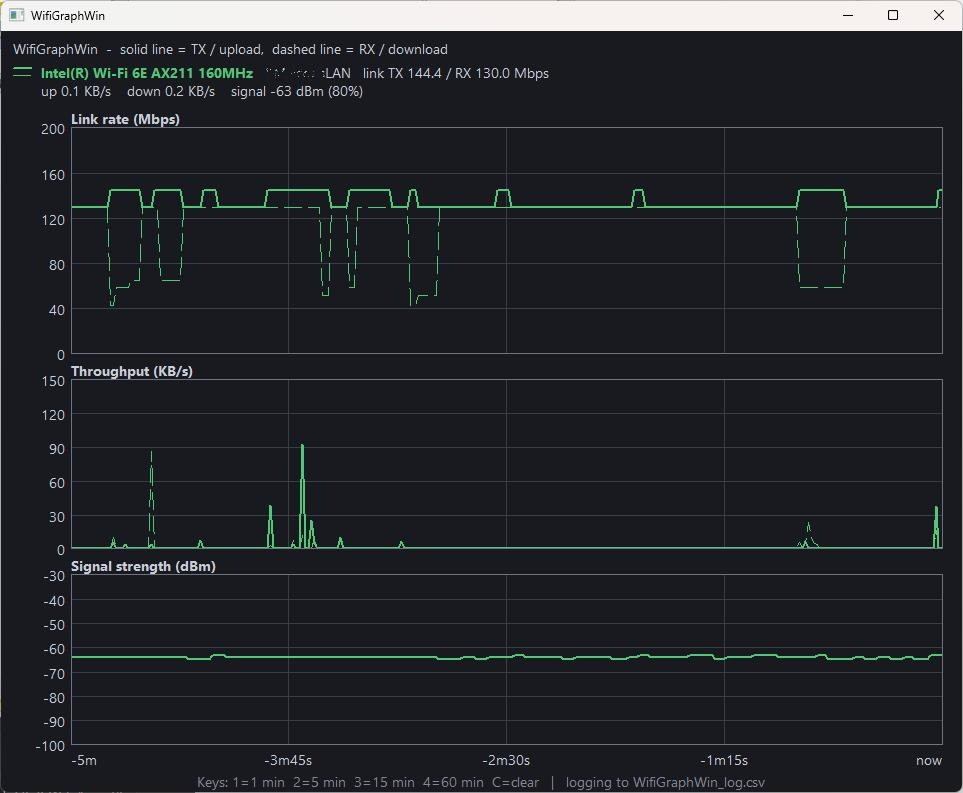

# WiFiGraphWin
Simple tool for creating WiFi / WLAN graphs of link speed, throughput and signal strength.

This application was originally developed to log the Wi-Fi settings of my brand-new ThinkBook 14 2-in-1 G5 IAU, which apparently has Wi-Fi issues when it's 3 meters away from the Wi-Fi router.
It will create a CSV log file of all captured vaules. 

Using [HTML viewer](WifiGraphWinViewer.html), you can limit the recorded measurement values to a specific time period and export the displayed data as a PNG or SVG file.

